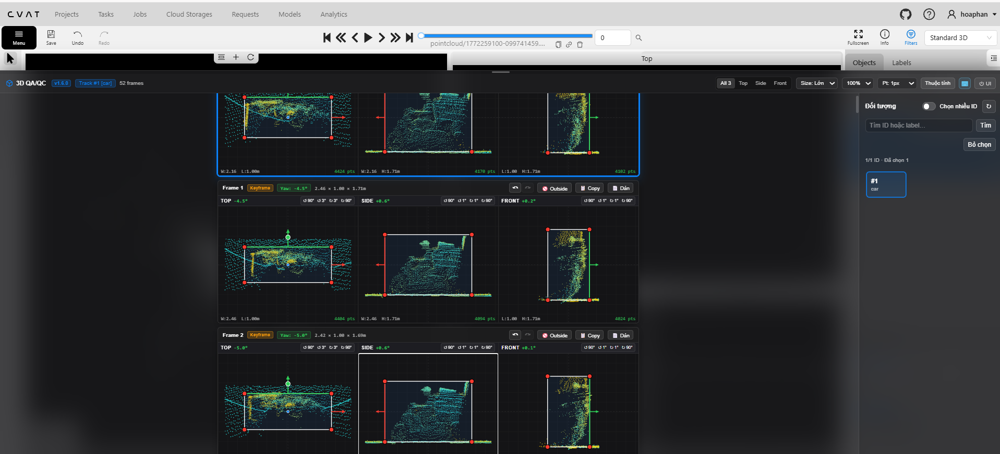

# Đề xuất kế hoạch — CVAT 3D Multi-Frame QA/QC Inspector

| Nội dung | Thông tin |
|---|---|
| Trạng thái | Bản dùng nội bộ nhóm — chờ mentor xem xét |
| Người dùng mục tiêu | Annotator và QA/QC |
| Phạm vi | CVAT 3D Point Cloud — quản lý và cập nhật cuboid/bounding box |

## 1. Mục tiêu
Sau một tuần thực hiện gán nhãn và QA/QC thì nhóm em thấy được **phần lớn thời gian người gán nhãn phải làm là phải chuyển qua lại giữa các frame** nhằm quan sát vi trí box. Khi một tác vụ phải lặp đi lặp lại mà giữa các tác vụ luôn phải chờ 0.5-1s vì phải load ảnh 3d lên UI khiến cho người gán nhãn cảm tháy mệt mõi và chán nãn. Nên nhóm em đề xuất ra tool này.

Tool mà nhóm em đề xuất la một Chrome Extension nhằm hỗ trợ Annotator và QA/QC quan sát và cập nhật box 3D thuận tiện hơn trong CVAT trên 3 góc camera là top/front/side. Điều này giúp giảm thiểu các tác vụ chuyển frame lặp đi lặp lại.

## 2. Giải pháp đề xuất

Sau khi tìm hiểu thì nhóm thấy được dữ liệu cuboid đã được load từ ban đầu hết về ổ đĩa trình duyệt. Nên việc trích suất ảnh 3d là chỉ việc lấy dữ liệu từ cơ sở dữ liệu trình duyệt lên UI. Vì vậy nhóm đã hiển thị 3 camera ở top/side/front để người dùng cập nhập trược tiếp mà không cần chuyển qua lạic các frame. Với một số đề xuất sau.

- Hiển thị một object qua nhiều frame với ba góc nhìn Top, Front và Side.
- Cho phép cập nhật vị trí, kích thước, hướng và trạng thái box ngay tại frame đang kiểm tra.
- Cung cấp phím tắt và các thao tác theo track để chỉnh box nhanh hơn.
- Hỗ trợ căn chỉnh box sát mặt đường dựa trên point cloud của frame đang kiểm tra.

## 3. Ưu điểm và nhược điểm

### Ưu điểm chính

- Hỗ trợ quan sát một object xuyên suốt nhiều frame và trên ba góc nhìn.
- Cho phép chỉnh trực tiếp box tại frame đang kiểm tra, giảm thao tác chuyển đổi giữa các màn hình.
- Không tạo request riêng tới server, không lưu dữ liệu annotation trên máy cá nhân và không cần bên thứ ba.

### Nhược điểm chính

- Chưa có dữ liệu pilot để chứng minh hiệu quả khi áp dụng thực tế.
- Phụ thuộc vào giao diện và cơ chế nội bộ của CVAT nên cần kiểm tra lại khi CVAT thay đổi.
- Chức năng căn mặt đường phụ thuộc vào chất lượng point cloud và cần người dùng xác nhận trước khi lưu.

## 4. Hướng thực hiện nếu được phê duyệt

Nhóm có 2 hướng để phát triển thêm extension này:
- Sau khi được phê duyệt, tool sẽ được kiểm chứng trên job 3D thực tế. Quá trình này tập trung vào khả năng chỉnh sửa và lưu box, Undo/Redo, track dài, các trạng thái box đặc biệt, chức năng căn mặt đường, request mạng và phản hồi của người dùng.
- Nhóm sẽ thực hiện tìm kiếm các khâu gán nhãn tiêu tốn thời gian nhiều để tìm các giải pháp tiết kiệm thời gian hơn. Ví dụ như RANSAC nhằm giảm thiểu tác vụ canh chỉnh thẳng với mặt đường

Với hai hướng trên thì chúng em vẫn cần hướng đi phù hợp cho extension này ạ.

